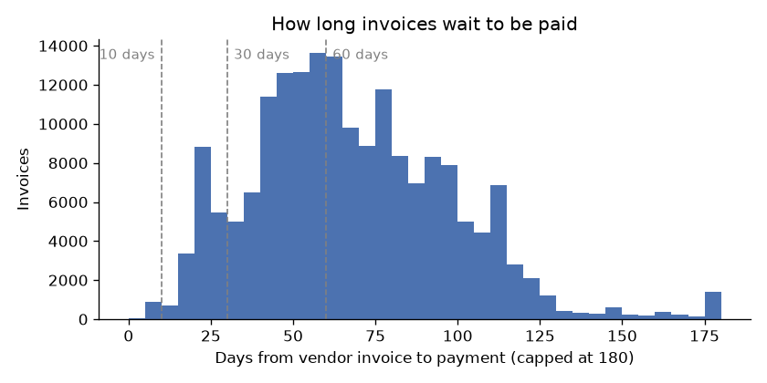
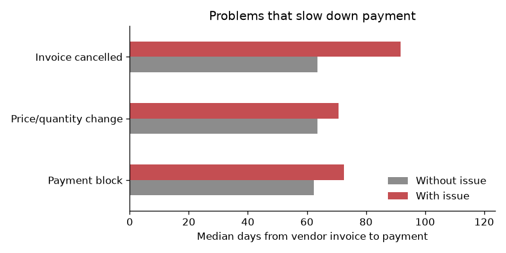
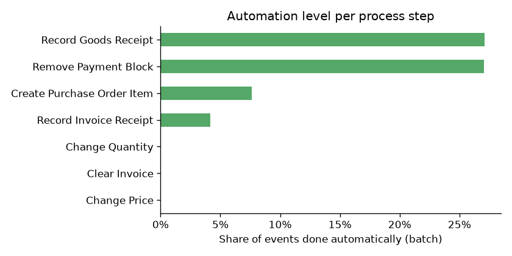

# Purchase-to-pay process analysis on real company data

In my [first project](https://github.com/ramya-rajendra/invoice_automation) I analysed invoice processing with synthetic data. Here I wanted to check the same questions on real data: the BPI Challenge 2019 event log, which covers 1.6 million process steps from the purchase-to-pay process of a large multinational paint and coatings company.

The questions:
1. Is the data clean enough to use?
2. How long does it take from the vendor's invoice to payment, and where does the time go?
3. Do payment blocks and order changes slow payment down?
4. Which vendors cause the most delay?
5. How much of the process is already automated?

## The data

| | |
|---|---|
| Events (process steps) | 1,595,923 |
| Order items (cases) | 251,734 |
| Vendors | 1,975 |
| Process steps (activity types) | 42 |
| Period | mostly 2018 |

Each row is one step for one order item, for example *Create Purchase Order Item*, *Record Goods Receipt*, *Vendor creates invoice*, *Record Invoice Receipt*, *Clear Invoice* (paid). Company and vendor names are anonymised in the source.

## Findings

**1. The data needed cleaning first.** 97 events had impossible timestamps, going back as far as 1948. I removed the 82 order items they belong to, which is a small share, but it would have distorted every time calculation.

**2. Invoices take a long time to be paid.** Median time from the vendor's invoice to payment is **64 days**. Only 1% of invoices are paid within 10 days and 11% within 30 days. 56% take longer than 60 days.



The data has no payment terms, so this doesn't automatically mean the company pays late. Paying close to a 60-day term can be a deliberate cash decision. But it does mean that any early-payment discount offered by vendors is almost always lost. In a real project, the first thing I'd check is the payment terms per vendor.

**3. About 10 days pass before an invoice is even in the system.** The median time between the vendor's invoice date and *Record Invoice Receipt* is 10 days. Part of that is postal and email time, but it's the same "waiting to be typed in" problem as in my first project.

**4. Problems add real delay.**

| Issue | Share of paid cases | Median days with issue | Without | Extra days |
|---|---|---|---|---|
| Payment block | 27.6% | 72 | 62 | +10 |
| Price or quantity change | 10.9% | 71 | 64 | +7 |
| Invoice cancelled | 3.0% | 92 | 64 | +28 |



More than a quarter of paid order items had a payment block. Cancelled invoices are rarer but the most expensive: almost a month extra.

**5. A few vendors drive a large part of the problem.** The 10 biggest vendors account for 31% of all paid cases. The largest one (vendorID_0136) has over 10,000 cases, a payment block on 54% of them, and a median of 112 days to payment. That's where I'd start: one conversation with that vendor about why its invoices get blocked could affect thousands of cases.

**6. Most of the process is still done by people.** Only 10% of all events are done by batch (system) users. 41,694 payment block releases were done manually, so about 73% of all of them.



Releasing a payment block after the goods have arrived follows a clear rule, which makes it a good candidate for automation. That's the same idea as the routing logic in my first project.

## What I'd recommend

1. **Get the payment terms per vendor** and check how much early-payment discount is being lost
2. **Automate payment block releases** when goods receipt and invoice match, starting with the top vendors
3. **Talk to the top 3 vendors** with the highest block rates about the root cause (wrong prices, early invoices, missing goods receipts)
4. **Track invoice-to-record time** as a KPI, since every day spent waiting there is lost from the payment window

## Limitations

- Payment terms and discount conditions are not in the data
- Monetary values in the source are anonymised (scaled), so I didn't calculate euro amounts
- The *Vendor creates invoice* timestamp is the invoice date as reported, not the date it arrived
- Many order items have several invoices; I used the first invoice and the last payment per item
- Almost all paid cases are 3-way matching, so the 2-way match result (20 days) is based on only 297 cases

## How to run

```bash
conda env create -f environment.yml
conda activate p2p-real

# put BPI_Challenge_2019.xes into data/ (see data/README.md), then:
python src/convert_xes.py   # XES -> data/events.csv (about 1 minute)
python src/analyse.py       # findings, charts, results/summary.txt
python src/run_sql.py       # the same questions in SQL with DuckDB
```

## Project structure

```
data/      README.md with download link (data files not in the repo)
src/       convert_xes.py, analyse.py, run_sql.py
sql/       queries.sql (DuckDB, runs directly on the CSV)
images/    charts used in this README
results/   summary.txt with all numbers from analyse.py
```

**Tools:** Python (pandas, matplotlib), SQL (DuckDB), conda

**Data:** van Dongen, B.F. (2019). BPI Challenge 2019. 4TU.ResearchData. CC BY 4.0. https://data.4tu.nl/articles/dataset/BPI_Challenge_2019/12715853
